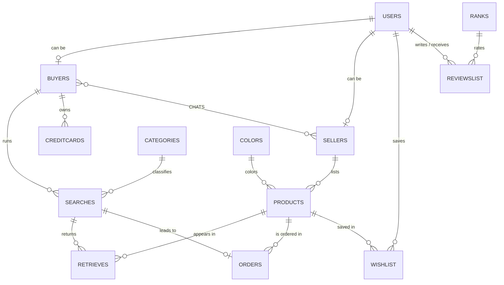

# Marketplace Database and SQL Analytics (Vinted case study)

Design and analysis of a relational database for **Vinted**, an online marketplace for second-hand
fashion: from the business process and ER model to a SQL Server schema, an analytical query layer
(joins, window functions, CTEs, views, functions, a stored procedure and a trigger) and views that feed
Power BI dashboards.

*Course project – Databases, Industrial Engineering & Management, Ben-Gurion University (January 2025).
Team project of three students.*

## Business question

How do buyers and sellers behave on the platform, and where is conversion lost? The queries focus on
search-to-order conversion by category, revenue by seller and city, buyers at risk of churning, and
which products attract attention without selling.

## Data model

14 tables: users (split into buyers and sellers), products, searches, the products each search retrieved,
orders, wishlists, chats between buyers and sellers, reviews, credit cards, and lookup tables for colors,
categories and review ranks. Integrity is enforced with primary and foreign keys, `UNIQUE` constraints
and `CHECK` constraints (username length, e-mail and phone format, minimum password length, positive
prices, zip-code pattern).



Design decisions: buyer and seller are subtypes of user (a user can be both); an order is linked to the
search that produced it, which makes search-to-order conversion measurable; the many-to-many links
(search to products, wishlist, chats) have their own tables.

## What the SQL covers

| Topic | Examples in `sql/02_analysis.sql` |
|---|---|
| Joins | Top 10 most expensive orders of the year; how often each product appears in searches |
| Nested queries | Buyers whose orders exceed the average price; revenue from sellers with more than 3 sales |
| Window functions | Seller revenue gap to the top seller per year with `RANK`; each buyer's search count versus the average over the last 3 months |
| CTE | Churn-risk classification (High / Medium / Low) from recent search activity |
| Views | 13 views, including conversion rate by category, revenue by city, last order per customer, searches by hour and weekday |
| Functions | Scalar `ConversionRate(category)` and table-valued `GetTopSearchedProductsByCategory(category)` |
| Stored procedure | `NotifyUsersForEngagement` finds users to re-engage (wishlist items, inactive, no orders, unsold products) |
| Trigger | `RemoveFromWishlist` deletes an item from the wishlist when the user orders it, with a test sequence |
| Optimization | Indexes on the join and filter columns, and a rewrite that computes the average once in a CTE instead of per row |

Twelve of the views were added for the Power BI dashboard part of the assignment. The two dashboard
files are not included in this repository because they embed the data model.

## Repository

```
sql/01_schema.sql              creates the VintedDB database, tables, constraints and lookup data
sql/01b_load_data.sql          loads the synthetic sample data (about 4,100 rows) with INSERT statements
sql/02_analysis.sql            queries, views, functions, stored procedure, trigger, indexes
data/vinted_sample_data.xlsx   the same sample data as a spreadsheet, for reference
```

## Running it

Requirements: SQL Server 2016 or later and SQL Server Management Studio.

1. Run `sql/01_schema.sql` (creates the database and tables; safe to re-run).
2. Run `sql/01b_load_data.sql` (loads the sample data in foreign-key order).
3. Run `sql/02_analysis.sql`, section by section if you want to inspect each result.

## Sample results

Output of the scalar function `ConversionRate` (search-to-order conversion) on SQL Server Express.
The data is synthetic, so the numbers illustrate the queries and are not real Vinted behavior.

| Category | Searches | Orders | Conversion |
|---|---|---|---|
| Clothing | 93 | 80 | 86.0% |
| Vintage | 25 | 21 | 84.0% |
| Accessories | 122 | 101 | 82.8% |
| Shoes | 56 | 45 | 80.4% |
| Home & Living | 159 | 122 | 76.7% |
| Baby & Kids | 20 | 15 | 75.0% |
| Sports Equipment | 25 | 16 | 64.0% |

## Notes on the data and scripts

- The sample data is synthetic. Passwords, e-mail addresses, phone numbers and card numbers were
  replaced with placeholder values, and each table was generated independently, so order card numbers
  do not match the cards table (the schema has no foreign key there).
- The sample data covers 1-13 January 2025. Queries that depend on the current date were anchored on the
  latest search in the data, otherwise they would return nothing today.
- **How the scripts were checked.** All three scripts were run in order on SQL Server Express with no
  errors: the schema was created, all 4,149 sample rows were loaded, and every statement of the analysis
  script (queries, views, both functions, the stored procedure, the trigger test and the indexes) ran
  without an error message. Before that, the schema, data and main queries were also checked on SQLite with
  foreign keys and CHECK constraints enforced. A missing comma in the original `WISHLIST` definition,
  which SQL Server rejects, was found and fixed that way.
- `NotifyUsersForEngagement` uses the latest search in the data as its reference date instead of `GETDATE()`.
  In this sample data every buyer has at least one order and every product appears in an order, so its
  "No Orders" and "Unlisted Product Not Sold" branches return no rows; the wishlist and inactive-user
  branches return results.
- Some comments inside the SQL are in Hebrew, as in the original submission.
